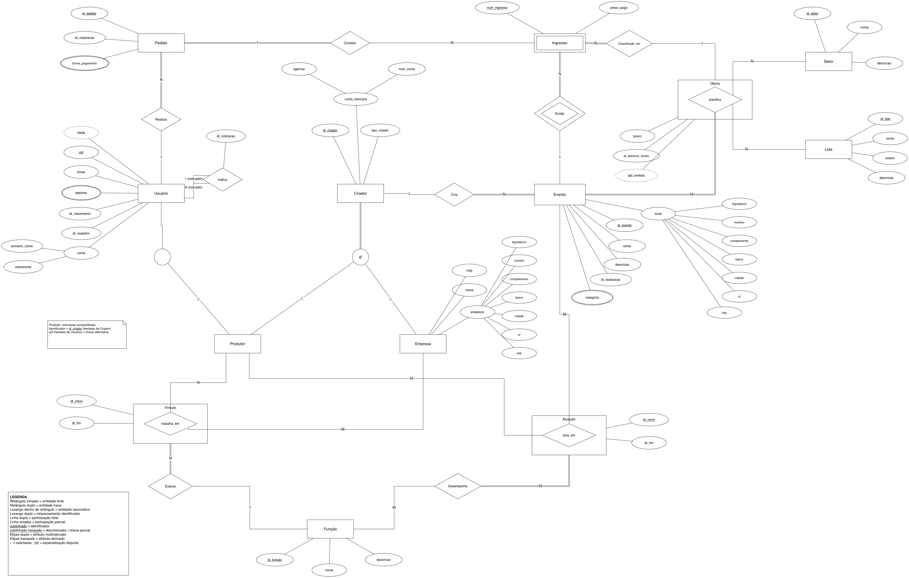

<h1 align="center">Plataforma de Eventos</h1>

  Projeto da disciplina <b>CIn0137 - Banco de Dados</b> 
  Centro de Informática - UFPE · 2026.2 · Grupo 9

  
  
  

## Sobre

Banco de dados de uma plataforma de venda de ingressos. Criadores (produtores ou empresas) publicam eventos, cada evento tem ofertas por setor e lote, e os usuários compram ingressos por meio de pedidos.

## Equipe

<table align="center">
  <tr>
    <td align="center" width="160">
      <a href="https://github.com/BrenoRev">
         
        <b>Breno Silva Xavier de Souza</b>
      </a> 
      bsxs · <a href="https://github.com/BrenoRev">@BrenoRev</a>
    </td>
    <td align="center" width="160">
      <a href="https://github.com/Djco21">
         
        <b>Danilo José Coutinho de Oliveira</b>
      </a> 
      djco · <a href="https://github.com/Djco21">@Djco21</a>
    </td>
    <td align="center" width="160">
      <a href="https://github.com/GabrielCFAyres">
         
        <b>Gabriel Carvalho Figueiredo Ayres</b>
      </a> 
      gcfa · <a href="https://github.com/GabrielCFAyres">@GabrielCFAyres</a>
    </td>
  </tr>
  <tr>
    <td align="center" width="160">
      <a href="https://github.com/jvlopess">
         
        <b>João Victor Cardoso Lopes</b>
      </a> 
      jvcl · <a href="https://github.com/jvlopess">@jvlopess</a>
    </td>
    <td align="center" width="160">
      <a href="https://github.com/joaocm1804">
         
        <b>João Carlos Melo Brennand de Souza Mendes</b>
      </a> 
      jcmbsm · <a href="https://github.com/joaocm1804">@joaocm1804</a>
    </td>
    <td align="center" width="160">
      <b>Alisson Vinícius Arruda de Paula</b> 
      avap2
    </td>
  </tr>
</table>

## Entregas

| Etapa | Conteúdo | Pasta |
|---|---|---|
| AV1 e AV2 | Minimundo e diagrama EER | [AV1-AV2](AV1-AV2/) |
| AV3 | Scripts de criação e povoamento das tabelas | [AV3](AV3/) |
| AV4 | Consultas SQL, função, procedure, package e triggers em PL/SQL | [AV4](AV4/) |

## Diagrama EER

  

